# CS6650 HW5: Product API on AWS ECS (Terraform)

A Go/Gin Product API implementing the Product endpoints from `api.yaml`,
containerized with Docker and deployed to AWS ECS (Fargate) via Terraform.

## Project Structure

| Path | Contents |
|---|---|
| `src/product-service.go` | Gin server: `GET /products/{productId}`, `POST /products/{productId}/details`; in-memory store seeded with products 1, 2, 3 |
| `src/go.mod`, `src/go.sum` | Go module and dependencies |
| `src/Dockerfile` | Multi-stage build for the Product API image |
| `terraform/` | Infrastructure as code (provider, variables, modules, main, outputs) |

## Prerequisites

- AWS CLI
- Terraform
- Docker (running)
- AWS Learner Lab credentials

## Instructions

### 1. Clone the Repo

```
git clone <YOUR-FORK-URL>
cd CS6650_2b_demo
```

### 2. Prepare Credentials

Retrieve your temporary credentials from Learner Lab.
Enter your configuration when prompted:

```
aws configure
```

Then set your session token:

```
aws configure set aws_session_token <YOUR-TEMP-SESSION-TOKEN>
```

> **Region:** your AWS CLI region must match `aws_region` in `terraform/variables.tf`.
> If they differ, the CLI commands below will fail with `ClusterNotFoundException`.
> Fix with: `aws configure set region <region-from-variables.tf>`

### 3. Apply Infrastructure

```
cd terraform
terraform init
terraform apply -auto-approve
```

Terraform builds the Docker image from `src/`, pushes it to ECR, and runs it on ECS.

### 4. Get the Public IP

Run this from inside the `terraform/` folder:

```
aws ec2 describe-network-interfaces \
--network-interface-ids $(
    aws ecs describe-tasks \
    --cluster $(terraform output -raw ecs_cluster_name) \
    --tasks $(
        aws ecs list-tasks \
        --cluster $(terraform output -raw ecs_cluster_name) \
        --service-name $(terraform output -raw ecs_service_name) \
        --query 'taskArns[0]' --output text
    ) \
    --query "tasks[0].attachments[0].details[?name=='networkInterfaceId'].value" \
    --output text
) \
--query 'NetworkInterfaces[0].Association.PublicIp' \
--output text
```

Save it (IP only, no port):

```
IP=<PUBLIC-IP-ADDRESS>
```

## Send Requests

All examples use `-i` to show the HTTP status code.

The store starts with three seeded products (IDs `1`, `2`, `3`). POST is
update-only: it changes an existing product's details and returns 404 for
any ID that isn't already in the store.

### GET /products/{productId}

**200: product found** (seeded product)
```
curl -i http://$IP:8080/products/1
```

**404: product not found** (ID not in the store)
```
curl -i http://$IP:8080/products/99
```

**500: internal server error** (simulated, see below)
```
curl -i http://$IP:8080/products/1 -H "X-Simulate-Error: true"
```

### POST /products/{productId}/details

**204: product details added**
```
curl -i -X POST http://$IP:8080/products/1/details \
  -H "Content-Type: application/json" \
  -d '{"product_id":1,"sku":"ABC-123-XYZ","manufacturer":"Acme Corporation","category_id":456,"weight":1250,"some_other_id":789}'
```

**400: missing required fields**
```
curl -i -X POST http://$IP:8080/products/1/details \
  -H "Content-Type: application/json" \
  -d '{"product_id":1,"sku":"ABC-123"}'
```

**400: invalid values**
```
curl -i -X POST http://$IP:8080/products/1/details \
  -H "Content-Type: application/json" \
  -d '{"product_id":1,"sku":"","manufacturer":"Acme","category_id":456,"weight":-5,"some_other_id":789}'
```

**400: malformed JSON**
```
curl -i -X POST http://$IP:8080/products/1/details \
  -H "Content-Type: application/json" \
  -d '{"product_id":1,'
```

**400: product ID mismatch** (`product_id` in the body must match `productId` in the path)
```
curl -i -X POST http://$IP:8080/products/1/details \
  -H "Content-Type: application/json" \
  -d '{"product_id":2,"sku":"NEW-1","manufacturer":"Acme","category_id":10,"weight":900,"some_other_id":100}'
```

**404: product not found** (POST to an ID that isn't seeded)
```
curl -i -X POST http://$IP:8080/products/99/details \
  -H "Content-Type: application/json" \
  -d '{"product_id":99,"sku":"NEW-99","manufacturer":"Acme","category_id":10,"weight":900,"some_other_id":100}'
```

**500: internal server error**

A real 500 can't be triggered from outside, because the in-memory map
can't fail. To test the 500 path, the server checks for an
`X-Simulate-Error: true` request header on both endpoints and, if present,
returns `500` with `{"error":"INTERNAL_ERROR","message":"Internal server error"}`.
```
curl -i -X POST http://$IP:8080/products/1/details -H "X-Simulate-Error: true"
```

## Part IV: Load Testing with Locust

Locust ran in Docker on my Mac (1 master plus 1 or 4 workers) against the
Product API on ECS in us-west-2.

- **Request mix:** 3:1 GET to POST, on seeded product IDs 1, 2, 3.
- **Think time:** `wait_time = between(0.1, 0.5)` seconds per user.

| Run | Users | Workers | Client | RPS | p50 | p95 | p99 | Fails |
|---|---|---|---|---|---|---|---|---|
| 1 Baseline | 10 | 1 | FastHttpUser | 31.5 | 16 ms | 20 ms | 41 ms | 0% |
| 2 HW3 repeat | 50 | 1 | FastHttpUser | 157.8 | 16 ms | 60 ms | 100 ms | 0% |
| 3 Stress (at 1000) | 100–1000 | 4 | FastHttpUser | 2800 | 50 ms | 140 ms | – | 0% |
| 4a Comparison | 500 | 4 | HttpUser | 1355 | 62 ms | 100 ms | 150 ms | 0% |
| 4b Comparison | 500 | 4 | FastHttpUser | 1370 | 57 ms | 79 ms | 140 ms | 1 request |

### Run 1: Baseline (10 users)


### Run 2: HW3 repeat (50 users)

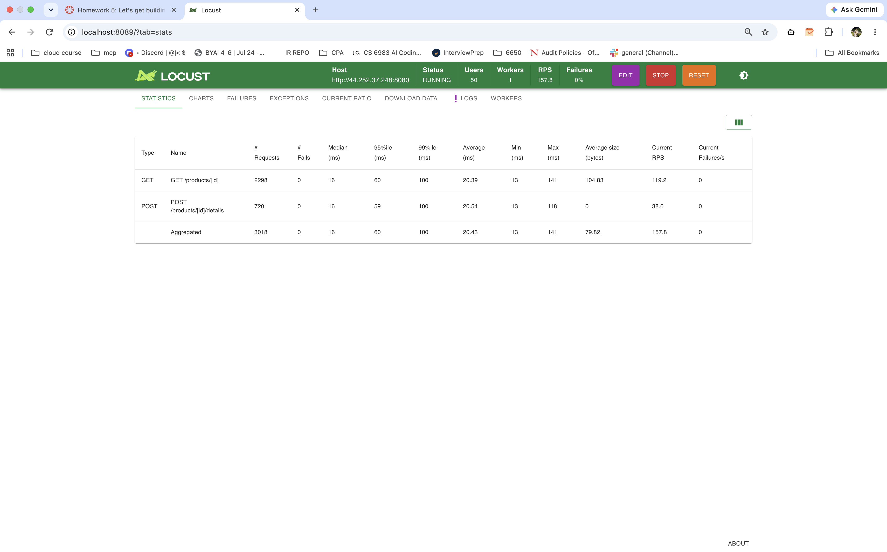

### Run 3: Stress test (100 to 1000 users)

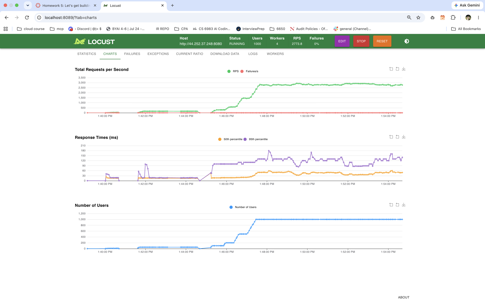

At 1000 users, the ECS task's CPU hit about 100%, so the server was the bottleneck:

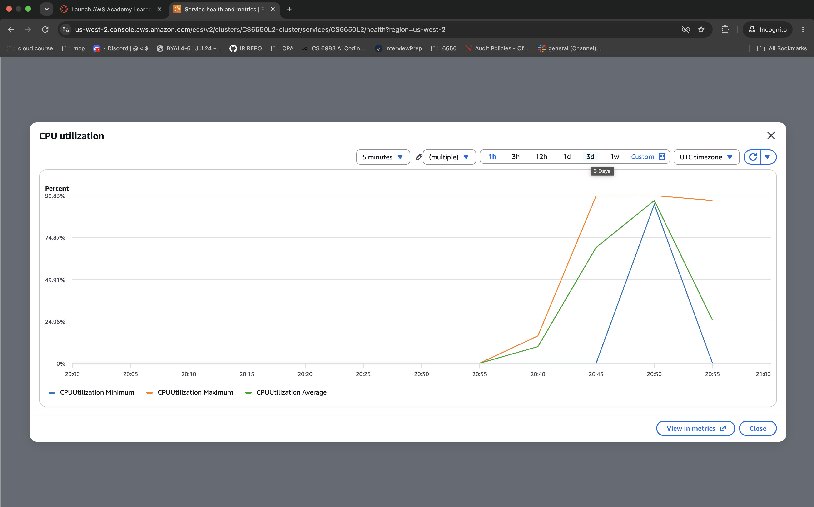

### Run 4a: HttpUser (500 users)


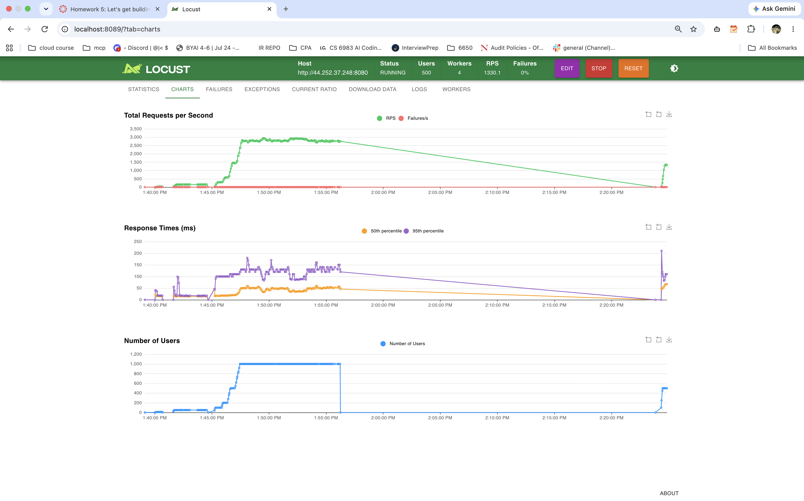

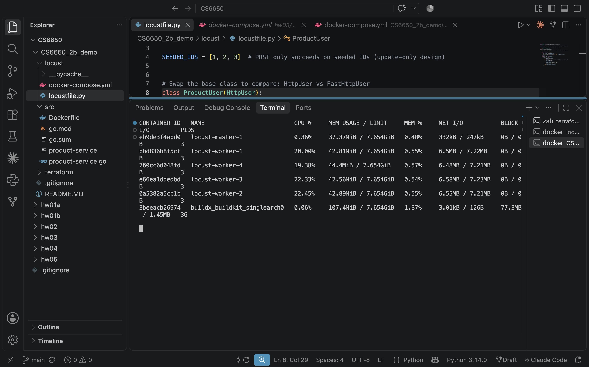

### Run 4b: FastHttpUser (500 users)

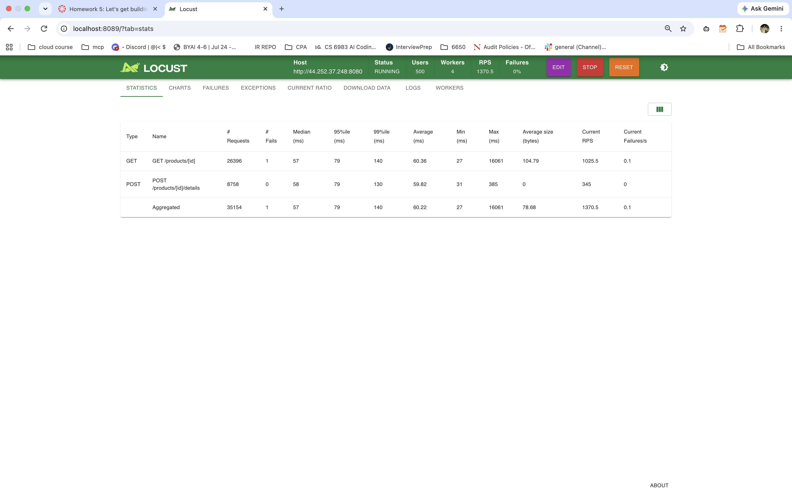

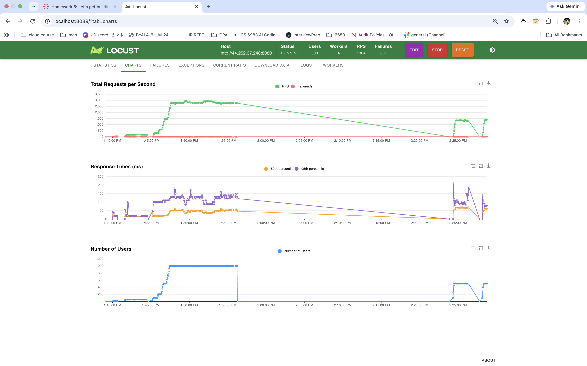

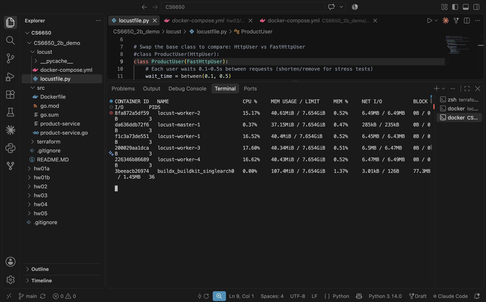

## Part V: Observability (Prometheus + Grafana)

RED metrics (Rate, Errors, Duration) are exposed at `/metrics`, and Prometheus
and Grafana run locally with `observability/docker-compose.yml`. Nothing
changed on ECS.

For the loaded run, Locust (FastHttpUser, 4 workers, 200 users) hit the app at
`host.docker.internal:8080` with GET seeded product, POST details and GET
missing product (ID 99999) in a 3:1:1 ratio.

### Dashboard: idle

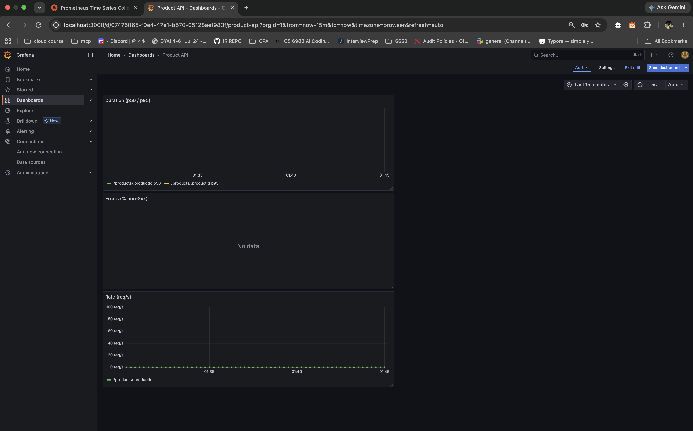

### Dashboard: loaded

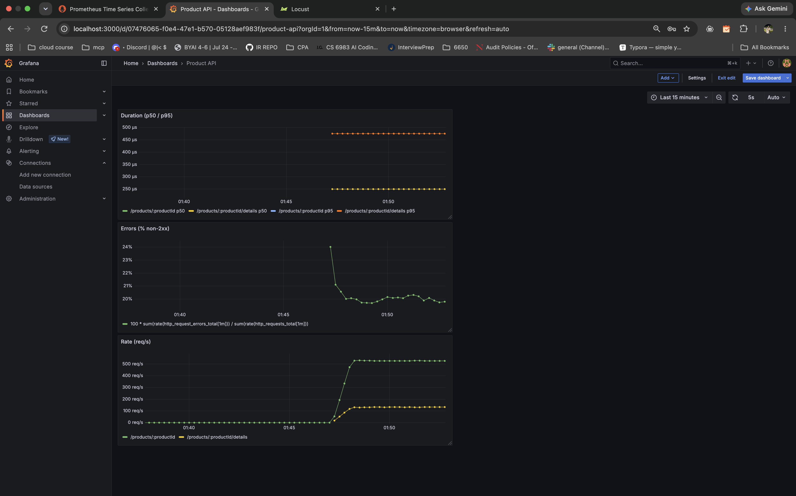

- **Rate:** about 650 req/s total under load.
- **Errors:** about 20%, which is the 1 in 5 share of missing-product (404) requests.
- **Duration:** p50 about 250 µs and p95 about 475 µs. These flat lines come from
  the bucket choice: real requests took 2 to 90 µs, below the smallest 0.5 ms bucket.

### Log excerpt (same run)

```
{"time":"2026-10-19T08:53:02.349999254Z","level":"INFO","msg":"request","endpoint":"/products/:productId","path":"/products/3","method":"GET","status":200,"duration_ms":0.004}
{"time":"2026-10-19T08:53:02.380858712Z","level":"INFO","msg":"request","endpoint":"/products/:productId","path":"/products/99999","method":"GET","status":404,"duration_ms":0.011}
{"time":"2026-10-19T08:53:02.380884087Z","level":"INFO","msg":"request","endpoint":"/products/:productId/details","path":"/products/3/details","method":"POST","status":204,"duration_ms":0.035}
{"time":"2026-10-19T08:53:02.384924879Z","level":"INFO","msg":"request","endpoint":"/products/:productId/details","path":"/products/1/details","method":"POST","status":204,"duration_ms":0.092}
```

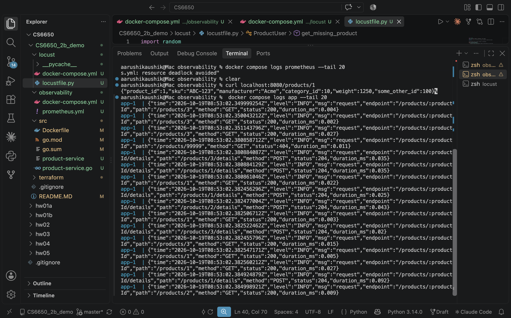

### Dashboard vs logs

I would look at the dashboard first, while something is happening, to see live
aggregate trends across all requests: whether traffic, error rate or latency
has changed and when. I would look at the logs after the fact, to investigate
specific requests, such as which path returned the 404s or exactly how long one
slow request took, especially when nobody had Grafana open at the time.

## Notes

- **Apple Silicon (ARM) Macs:** the Docker build in Terraform sets
  `platform = "linux/amd64"`, because ECS Fargate runs x86_64 by default.
  Without it, the task crashes with `exec format error`.
- The server listens on port `8080`, matching `container_port` in `terraform/variables.tf`.
- Products are stored in memory (a map guarded by `sync.RWMutex`), so any POST updates are lost
  whenever the task restarts, and the store goes back to the three seeded products.
- `.gitignore` keeps large files (`.terraform/`, `*.tfstate`, compiled binaries) and sensitive data
  (`.env`, `*.tfvars`, keys) out of the repository.

## Clean Up

```
terraform destroy -auto-approve
```